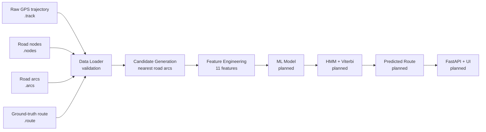

# PathSnap Progress Report Format

Use this structure for every future progress report:

1. **What the project is** — explain the project in simple language.
2. **Current system design** — include a Mermaid flow diagram.
3. **What has been completed** — show visual progress bars.
4. **How the pipeline works** — explain the current data flow with ASCII art.
5. **Dataset status** — report only observed counts and facts.
6. **Verification status** — include commands actually run and their observed results.
7. **Honest overall progress** — separate implemented, verified, planned, and blocked work.
8. **Checkpoint/deliverable summary** — explain what the current milestone does and does not include.
9. **Recommended next steps** — show the work sequence visually.
10. **Bottom line** — summarize the project state in plain language.

## Reporting rules

- Keep the report visual and beginner-friendly.
- Use ASCII progress bars, ASCII diagrams, and Mermaid where useful.
- Distinguish clearly between implemented, tested, planned, and blocked work.
- Never invent metrics, routes, API contracts, startup results, or test results.
- Include exact commands and observed outputs when verification was performed.
- Mention blockers and assumptions explicitly.
- Keep the newest report below older reports; do not rewrite historical reports unless correcting a factual error.

---

# PathSnap Progress Report — 18 November 2026

## 1. What is the project?

PathSnap is a GPS map-matching system.

A GPS device produces noisy location points. PathSnap identifies the real road segments that most likely produced those points and eventually reconstructs the vehicle's route.

```text
Input:  noisy GPS trajectory
Output: most likely sequence of road segments
```

## 2. Current system design



The current repository reaches the feature-engineering stage. The ML model, HMM/Viterbi decoder, API, and UI are documented designs but are not implemented yet.

## 3. What has been completed

```text
Data loading & validation        [██████████] 100%
Train/validation splitting       [██████████] 100%
Candidate road search            [██████████] 100%
Feature engineering              [████████░░]  80%
Unit test coverage               [███████░░░]  70%
ML model training                [░░░░░░░░░░]   0%
HMM / Viterbi routing             [░░░░░░░░░░]   0%
FastAPI backend                   [░░░░░░░░░░]   0%
Frontend map UI                   [░░░░░░░░░░]   0%
```

Implemented areas include:

- Robust parsers for `.track`, `.nodes`, `.arcs`, and `.route` files.
- Coordinate, timestamp, node-reference, and route-reference validation.
- Group-aware train/validation splitting using `GroupKFold`.
- KDTree-based nearby-road candidate generation with a brute-force fallback.
- Eleven geometric, temporal, and topological features.
- Unit tests for the data, candidate, split, and feature modules.
- Dataset inventory and smoke-test scripts.

## 4. How the current pipeline works

```text
                  ONE GPS OBSERVATION
                         │
                         ▼
              ┌────────────────────┐
              │ Search nearby roads │
              │ K = 10 candidates   │
              └──────────┬─────────┘
                         │
          ┌──────────────┼──────────────┐
          ▼              ▼              ▼
     Road Arc 41     Road Arc 88     Road Arc 102
     12.4m away      18.7m away      31.2m away
          │              │              │
          └──────────────┼──────────────┘
                         ▼
              Extract useful evidence:
              • distance to road
              • direction difference
              • position along road
              • road length
              • node connectivity
              • previous-road continuation
                         │
                         ▼
                ML model will rank them
```

## 5. Dataset status

Observed repository facts:

```text
Training trips:       80
Student test trips:   10
Evaluator test trips: not included
```

The milestone notes record the following observed values for training trip `00000001`:

```text
GPS observations:     1,315
Road nodes:           88,809
Road arcs:            165,790
Ground-truth route:  525 arcs
```

## 6. Verification status

The virtual environment exists and uses Python 3.13.5. The latest full test execution produced:

```text
21 tests passed
5 tests failed
```

Observed failures are concentrated in feature engineering:

1. Perpendicular-distance test mismatch.
2. Arc-length expectation mismatch.
3. `engineer.py` expects `candidate_set.candidate`, but the object exposes `candidate_set.candidates`.
4. Feature-matrix construction fails because of the same field mismatch.
5. No-NaN feature test fails because feature extraction does not complete.

The dataset inventory was run as a module:

```powershell
python -m scripts.dataset_inventory --data-root "Student folder\Student folder" --output experiments\dataset_inventory_report.json
```

Observed result: the loader discovered 80 training trips, then stopped on trip `00000002` because longitude `11.043183` was rejected by the current `[8.0, 9.5]` longitude bounds.

Direct script execution also produced an import error:

```text
ModuleNotFoundError: No module named 'src'
```

The module form is therefore the correct current invocation style for those scripts.

## 7. Honest overall progress

```text
                    PROJECT STATUS

Concept and architecture       [██████████] 100%
Repository setup                [██████████] 100%
Dataset included                [██████████] 100%
Data loader                     [████████░░]  90%
Leakage-safe splitting          [██████████] 100%
Candidate generation            [████████░░]  90%
Feature engineering             [███████░░░]  70%
Automated verification          [██████░░░░]  60%
ML models                       [░░░░░░░░░░]   0%
HMM/Viterbi route decoding      [░░░░░░░░░░]   0%
Backend API                     [░░░░░░░░░░]   0%
Frontend demonstration UI       [░░░░░░░░░░]   0%

Estimated full-project progress: approximately 35–40%
```

This estimate is a planning summary, not a measured model score.

## 8. Checkpoint/deliverable summary

The 11:30 checkpoint delivered a preprocessing and feature-engineering baseline:

```text
Raw files
   ↓
Validated trip objects
   ↓
Nearby road candidates
   ↓
ML-ready feature matrix
```

It is not yet a trained predictor, complete route-reconstruction system, FastAPI service, or working frontend demonstration.

## 9. Recommended next steps

```text
NOW
 │
 ├─ Fix CandidateSet / feature-engineering failures
 ├─ Revisit coordinate validation bounds
 ├─ Run the full dataset inventory successfully
 └─ Run the real smoke test
      │
      ▼
NEXT
 │
 ├─ Implement and compare 5+ ML models
 ├─ Use GroupKFold validation
 ├─ Measure macro-F1 and candidate recall
 └─ Select/calibrate the strongest model
      │
      ▼
THEN
 │
 ├─ Add HMM/Viterbi sequence decoding
 ├─ Build FastAPI /predict endpoint
 ├─ Build map-based frontend
 └─ Test backend-to-frontend LAN communication
```

## 10. Bottom line

The team has built the foundation of PathSnap: data parsing, validation, leakage-safe splitting, nearby-road candidate generation, and ML feature construction.

The project is currently transitioning from:

```text
“Prepare the map-matching problem correctly”
```

to:

```text
“Train and evaluate a model that solves it”
```

• The upcoming milestone focuses on resolving feature-engineering failures, completing the real-data inventory, running a smoke test, and training the first baseline model.

